# Passenger

**Debugger, profiler and Hot Reload, built in.** The free IDE for C# and .NET: stop at a breakpoint and read every
line's values, change the code while it runs, see where the time and memory go, watch your XAML take shape as you type,
and debug every service of a compose file or an Aspire app. Your coding agent can use all of it too. Built on .NET 11,
it reads C# 15 and steps runtime async as written ([.NET 11](#net-11-and-c-15)). Free and open source under MIT, for
Windows, macOS and Linux ([installing](#installing)).

<p align="center">
  <a href="https://passenger-ide.net">Website</a> •
  <a href="https://passenger-ide.net/#download">Download</a> •
  <a href="docs/release-notes/0.3.4.md">What's new in 0.3.4</a> •
  <a href="#what-it-does">What it does</a> •
  <a href="#installing">Installing</a> •
  <a href="#your-coding-agent-using-the-ide-as-you-do">Your coding agent</a> •
  <a href="#building">Building</a> •
  <a href="CONTRIBUTING.md">Contributing</a>
</p>

<picture>
  <source media="(prefers-color-scheme: light)" srcset="site/images/debugger-light.webp">
  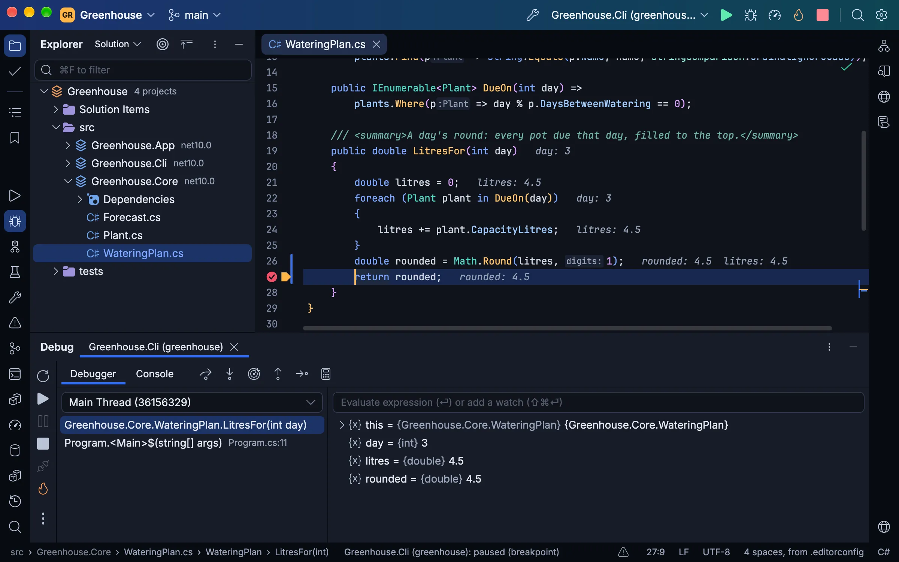
</picture>

Tools like these are usually found in paid IDEs or add-ons. In Passenger they are part of the IDE, free and open source
under MIT, for work and personal projects alike, with no account, no licence key and no telemetry:

- **A debugger with Hot Reload:** your edits put in the running program, the values methods returned, Smart Step Into,
  decompiled libraries, and several programs debugged at once.
- **CPU and memory profiling:** call trees, flame graphs, and heap snapshots compared.
- **XAML previews and live trees for Avalonia and WPF:** completion and checks, a preview as you type, the running app's
  Live Visual Tree, and XAML Hot Reload.
- **An IDE your agent can drive:** Claude Code, Codex, OpenCode or any MCP agent builds, tests, debugs and profiles
  through Passenger, and tries the app or game it builds.
- **Live requests with their SQL,** N+1s marked, and **EF Core migrations** with what would stop `dotnet ef` fixed
  first.
- **Debugging in containers and under Aspire:** every .NET service of a compose file, a Dockerfile or an AppHost
  debugged, reloaded and profiled where it runs, Aspire's metrics charted.
- **Blazor WebAssembly, debugged in the browser,** beside the server's code, Hot Reload keeping the page up.
- **Failed tests, pictured:** a failed Avalonia headless test (xUnit v3) carries a picture of each window as it was, in
  a Unit Tests window that runs xUnit, NUnit, MSTest and TUnit, and Godot's GdUnit4, GUT and GoDotTest.
- **Local History and a three-way merge:** every version of your files Passenger has seen, and Git's conflicts merged.
- **Godot 4 games, in C# and GDScript:** the game run, debugged, profiled and Hot Reloaded, its C# checked against its
  scenes, its GDScript and shaders read as Godot reads them, and the running game's tree and values beside the code.

Coming from Visual Studio? Its keys are the default, and VS Code's and IntelliJ IDEA's are a setting away, each as
Rider's keymaps have it. On a Mac, where Visual Studio for Mac was retired in August 2024, Passenger is a full .NET IDE
that runs natively on Apple Silicon.

What comes next is in the [milestones](https://github.com/Zaneris/passenger/milestones), the release in progress among
them. The pictures here are of sample projects committed to this repository, in your system's light or dark.

## What it does

### .NET 11 and C# 15

Passenger is built on .NET 11 and runs on its own copy of it, carried inside it; your projects can target .NET 8 or
later. C# 15 reads as C# 15: a union is coloured where you declare it and shows in the debugger as the value it holds,
a collection expression's `with(…)` arguments build with no preview error, and project files complete `net11.0` and
`LangVersion` 15. Code compiled with .NET 11's runtime async steps as you wrote it: Step Over an `await` stops on the
method's next line once it goes on, whichever thread it goes on, and Step Out stops in the caller that awaited it,
showing the value the method returned. Live metrics, the Requests window and an agent's telemetry read a .NET 11
program from its start, where an older one is first left a few seconds, and a memory snapshot reads its heap. Under Hot
Reload a debugged web app's open pages follow your edits through the .NET 11 SDK's browser refresh, the Migrations
window runs EF Core 11's `dotnet ef` with the defaults `.config/dotnet-ef.json` names, and a project built for .NET 10
and .NET 11 runs its tests under each. Open a .NET 11 project without its SDK and Passenger offers to install it into
your own folder.

### Debugging

Passenger's own debugger (started from SharpDbg and ICorDebugSharp, over ICorDebug): breakpoints with conditions, hit
counts and log messages, exception breakpoints, stepping through async code (.NET 11's runtime async too), Smart Step
Into, the values methods returned, Run to Cursor and Set Next Statement, watches and evaluation, and the values each
line used drawn after it. Several programs debug at once, each in a tab of its own. A frame in a library without symbols
shows its code, decompiled. Data breakpoints work on Windows x64, where the runtime supports them.

Edit the code while debugging and Hot Reload puts it in the program, paused or running. An edit it can't apply is listed
in Problems with why, and by default the program restarts to take it. Without the debugger, Hot Reload runs under
`dotnet watch`.

<picture>
  <source media="(prefers-color-scheme: light)" srcset="site/images/debugger-light.webp">
  
</picture>

Run | Attach to Process (Ctrl+Alt+P, ⌘⌥P on a Mac) lists the .NET programs on your machine and in every running
container, and debugs the one you choose as if Passenger had started it; Reattach to Process (Alt+Shift+P) attaches to
the last one again. On a Mac this needs no setup: no Developer Tools access, no debugger entitlement, no signing. The
debugger reaches a program's runtime through pipes in your temporary folder, so the program has to run as you, with your
`TMPDIR`, and with `DOTNET_EnableDiagnostics` not set to 0. .NET Framework and Mono are not Passenger's.

A Blazor Web App's WebAssembly components debug in the browser as its server's code does: breakpoints, steps, frames and
values, in Chrome, Edge or another Chromium, through .NET's own browser debug proxy, under Aspire and in containers too.
With Hot Reload a component's edit shows at once and a saved stylesheet applies with no reload.

### Profiling

A sampling profiler over the runtime's EventPipe, from a program's first instruction or attached to one already running:
its call tree, hot spots, flame graph, allocations and garbage collections, narrowed to any stretch of the timeline. A
memory snapshot counts the heap by type, with each object's retained size and the shortest paths that keep it alive; two
snapshots compared say which objects are new, which died and which survived.

<picture>
  <source media="(prefers-color-scheme: light)" srcset="site/images/profiler-light.webp">
  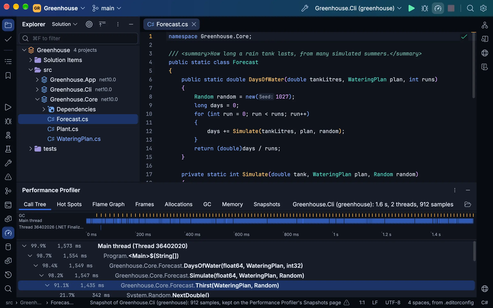
</picture>

### Avalonia and WPF

`.axaml` files get the help C# gets, from the project's own assemblies and Avalonia's own compiler and previewer:
completion of controls, properties, values, resources, selectors and binding paths checked against `x:DataType`, the
XAML compiler's errors on their lines, Go to Declaration into C#, a rename across C# and XAML either way, Extract
Resource and Extract Style, and a missing property, command or converter made from where it is used. XAML Preview draws
the file beside it as you type, and the XAML workspace sets the file, its preview and the running app's tree side by
side, one selection across them. A saved XAML file reaches the running Avalonia or WPF app with XAML Hot Reload.

<picture>
  <source media="(prefers-color-scheme: light)" srcset="site/images/xaml-light.webp">
  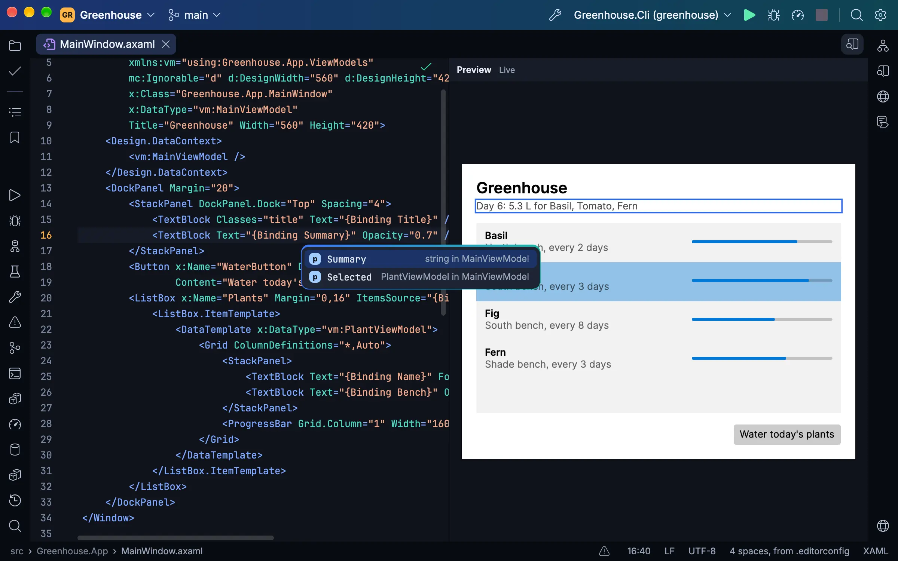
</picture>

Debug an Avalonia app and the Live Visual Tree shows its controls as they are, each property with where its value came
from and each style with why it applies or not, and the XAML shows each binding's value after its line. Breakpoints go
on an element, one of its attributes, or a property's next change, and a failed binding is a row in Problems with a fix
that can stop the debugger like an exception. The profiler charts an Avalonia app's frames, and a failed
Avalonia.Headless test (xUnit v3) carries a picture of each window as it was.

<picture>
  <source media="(prefers-color-scheme: light)" srcset="site/images/live-tree-light.webp">
  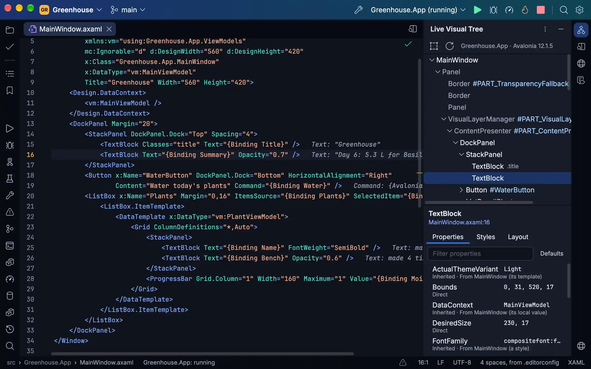
</picture>

WPF projects get the same XAML help on every system, with binding paths checked against the design-time data context. On
Windows, XAML Preview draws WPF files, and a debugged WPF app's Live Visual Tree shows where each value came from and
which styles and triggers set it, with Break When Value Changes and its failed bindings. Elsewhere a WPF or Windows
Forms project builds for its code help and says it runs only on Windows.

### Containers and Aspire

Each compose file (with its override), each project with a Dockerfile or that asks the .NET SDK for its image, each
`.dcproj` and each Aspire AppHost is a run configuration as the solution opens, and every .NET service in it runs under
the debugger, Hot Reload and profiler. Passenger works through your own `docker` command and whatever its context
reaches: Docker Desktop, Colima, OrbStack, Rancher Desktop, Podman or a remote engine. By default it builds the .NET
services itself and runs each from its build, so a code change needs no image rebuild and Rerun restarts only the
services whose build changed. Debug holds each service at its start and attaches inside its container, and one service
can be debugged, restarted or profiled while the others run on. New Solution and New Project write a new service's
Dockerfile, compose file or AppHost, ready to Run or Debug.

The Containers window lists Compose projects with their services, every other container, images, volumes and networks,
with their logs, stats, files and details. Dockerfiles and compose files get language servers, BuildKit's checks and
Compose's own reading as you type. Publish ships the SDK's container image with several tags and platforms, and an
image's known vulnerabilities show through your own Docker Scout when you ask.

Aspire's orchestrator asks Passenger to start each project resource of an AppHost. The Aspire window shows the resources
with their state, health and addresses, their consoles, logs and traces, their references and waits both ways, each
one's metrics charted, and the AppHost as a graph; the containers it makes go with its run. A service that reads a
connection string its AppHost never gives it is marked, with a fix that adds the `WithReference`.

<picture>
  <source media="(prefers-color-scheme: light)" srcset="site/images/aspire-light.webp">
  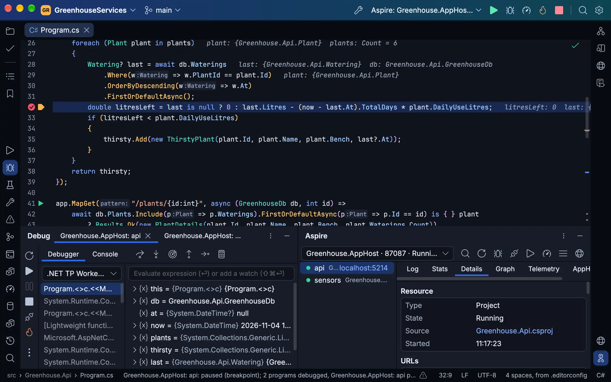
</picture>

### Web apps and their data

The Requests window shows each request a running web app serves and the database commands it ran, with their times and
rows, an N+1 or a slow query marked, for Run, Debug and Profile and for the services of a compose run or an AppHost:
Passenger reads ASP.NET Core's and EF Core's own events, only while you look. The Migrations window lists each
DbContext's migrations and whether the database has them, and fixes what would stop `dotnet ef` (the tool, the Design
package, a provider behind) before it runs. The Endpoints window lists your `.http` files' requests and each web
project's routes, read from its code with no build, and makes requests from the app's OpenAPI document. Turn on Collect
logs and traces and a run's OpenTelemetry logs and traces show beside its console.

<picture>
  <source media="(prefers-color-scheme: light)" srcset="site/images/requests-light.webp">
  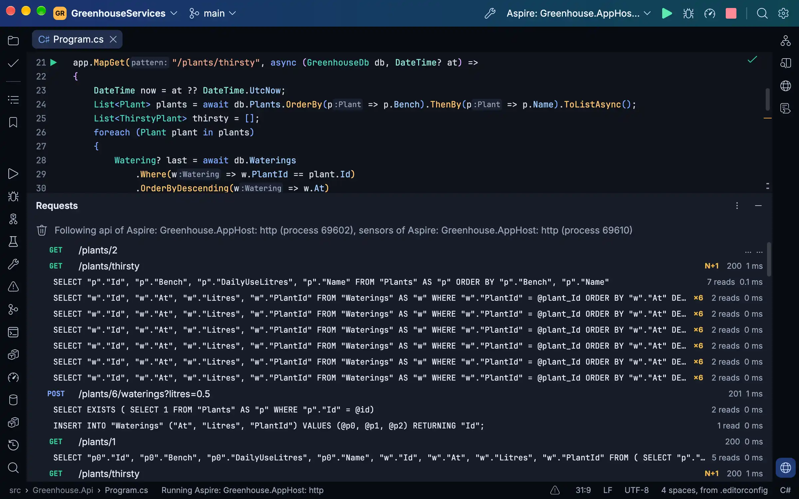
</picture>

### Godot 4

A Godot 4 game, in C# or in GDScript alone, runs, debugs, profiles and Hot Reloads on the Godot Settings › Godot names
or the one found. A breakpoint in C# or GDScript stops the game and a saved script reloads in it; Run Current Scene
plays the scene open, Run Another Copy plays up to 16 copies for multiplayer, and on Windows, macOS and Linux under X11
the game can draw in a pane beside its code. New Project makes a game, Publish exports it through its presets, and
`project.godot` opens as a page of its settings.

The game's C# is read against its scenes: `GetNode<T>` paths and types, `res://` and `uid://` paths, `[Export]` values,
signals and their handlers, and every string Godot takes (input actions, groups, animations, autoloads, shader
parameters, translations, layers, theme items) complete, are checked and rename, and a scene is marked where Godot would
not load it, with fixes. GDScript is read by Passenger's port of Godot's parser and analyzer: Godot's warnings and
errors with their fixes, completion, the hover, Find Usages, refactorings that reach C# and the scenes, and Reformat
Code by Godot's style guide, mostly without starting Godot. Shaders are checked as Godot's compiler checks them, every
error and warning at once.

<picture>
  <source media="(prefers-color-scheme: light)" srcset="site/images/gdscript-light.webp">
  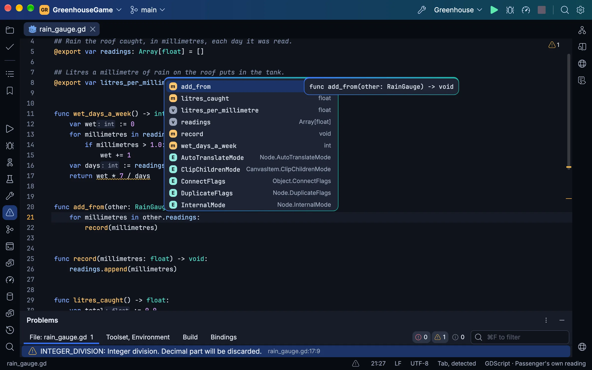
</picture>

While the game runs, the Live Visual Tree shows its scene tree and values, tuned while it plays and kept into the scene,
a node picked by clicking in the game; its members' values show after their lines, and its errors stay pinned to them
after the run. A profile holds GDScript's functions and Godot's frame times beside the C# in one call tree. GdUnit4, GUT
and GoDotTest tests run and debug in the Unit Tests window, GdUnit4's engine tests on Godot 4.7 for now. Passenger's addon for Godot's editor debugs in Passenger the
game Godot's own Play starts, and Passenger becomes Godot's script editor in one step. The website's
[Godot page](https://passenger-ide.net/godot) has the rest.

### The editor and C#

A text control of its own over an immutable rope: multiple carets, folding, soft wrap, Extend Selection, live, postfix
and surround templates, inlay hints, and splits and tabs in windows of their own; a key costs what it changed, not the
file's size. C# comes from Roslyn: diagnostics, completion, quick fixes and refactorings (Change Signature, Extract
Interface, Move, Pull Members Up, Safe Delete and more), Go to Declaration, Implementation and Base Symbols, Find
Usages, call and type hierarchies and decompiled library sources, and Problems lists the whole solution's without a
build. A file-based program (`dotnet run app.cs`) opens as a project of its own, and a solution filter (`.slnf`) loads
only the projects it names.

<picture>
  <source media="(prefers-color-scheme: light)" srcset="site/images/editor-light.webp">
  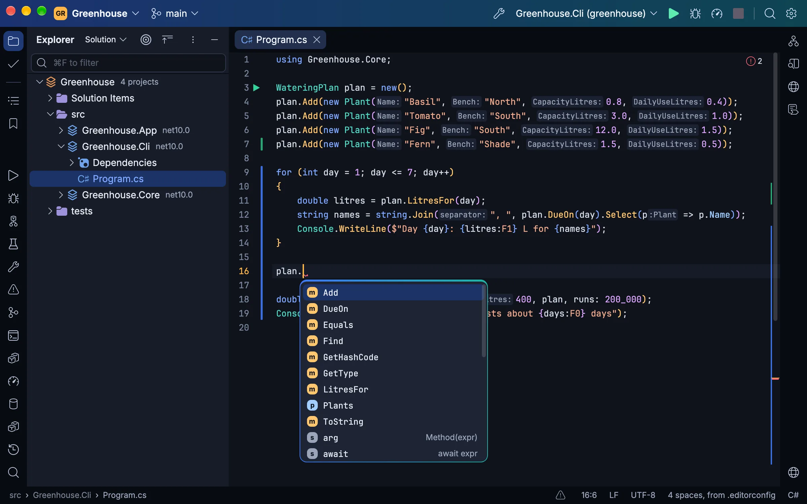
</picture>

Razor and Blazor files get C# and HTML help together, and a class attribute completes from every stylesheet the page
uses. Project files complete their properties, items and package versions, with each property's evaluated value.
JavaScript, TypeScript, HTML, CSS, JSON, Dockerfiles and YAML go through their language servers on Node.js, ESLint's
fixes and the project's own Prettier included. Twelve looks of its own, each dark and light, and every file with an icon
in each look's colours.

<picture>
  <source media="(prefers-color-scheme: light)" srcset="site/images/themes-light.webp">
  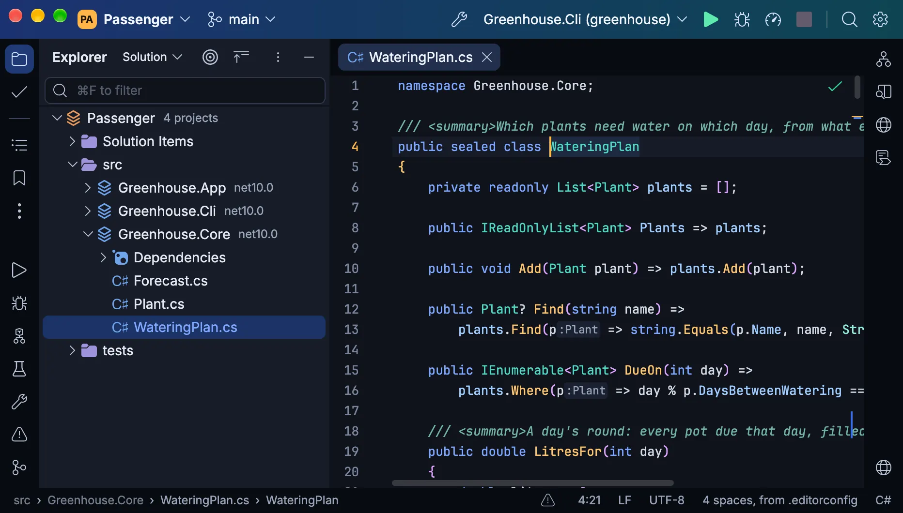
</picture>

### And the rest

- **Git:** the Commit window, the log with its branch graph, side-by-side diffs with the changed words marked, blame,
  change bars that roll a change back, the history of a file, a folder or a selection, stashes, conflicts resolved in a
  three-way merge, and commits signed with SSH, GPG or X.509, each signature shown in the log.
- **Search:** Search Everywhere, Go to File, Go to Symbol and Find Action, Find and Replace in Files, Find Usages and
  Show Usages, Recent Files and Recent Locations, bookmarks and File Structure; a click with a modifier, or a mouse
  button of its own, runs any action you bind to it.
- **Build, run and publish:** a Solution view as MSBuild evaluates it, builds with their errors in Problems, run
  configurations from your launch profiles, consoles whose stack frames link to their lines, and Publish to a folder, a
  container image or an Aspire AppHost's own publishers and deploy steps.
- **Unit tests:** xUnit, NUnit, MSTest and TUnit, through VSTest or Microsoft.Testing.Platform, and a Godot game's
  GdUnit4, GUT and GoDotTest tests, found from the code before any build, any test debugged, and each test's last
  results kept across restarts.
- **NuGet:** your `nuget.config`'s feeds, packages installed, updated and removed, central package management, and
  vulnerable versions marked with the lowest that fixes them.
- **Local History, a terminal, tables and previews:** every version of your files Passenger has seen; a terminal
  emulator of its own; CSV, TSV, Excel, `.resx` and XLIFF files as tables, and images, fonts, SVG and HTML files
  previewed.
- **Updates** that install themselves on Windows, macOS and Linux, then show what's new.

<picture>
  <source media="(prefers-color-scheme: light)" srcset="site/images/git-light.webp">
  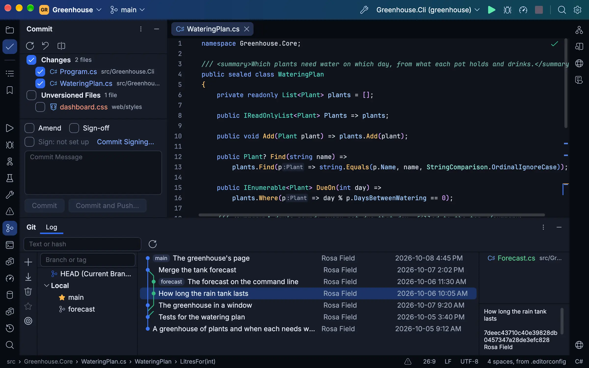
</picture>

## Installing

[passenger-ide.net](https://passenger-ide.net/#download) has each system's download:

- **macOS:** a disk image for Macs with Apple Silicon. Drag Passenger onto Applications.
- **Windows:** an installer for x64 or Arm64, which installs for you alone, with no administrator.
- **Linux:** an archive for x64 or Arm64. Unpack it and run its `install.sh`, for you alone or with `--system` for
  everyone; the command is `passenger-ide`, so it never meets Phusion Passenger's `passenger`. Its
  [Linux page](https://passenger-ide.net/linux) names the libraries it needs, and `install.sh` names your
  distribution's font package where it finds no font.

A copy the installer, the disk image or `install.sh` put in place updates itself, then shows what's new. Passenger
needs:

- **a .NET SDK** for the projects you open (.NET 8 or later), which it builds and runs them with. Without one,
  Passenger says what is missing and installs one in a step, once you agree; its own language server, project host and
  debugger run on the .NET it carries, whatever the machine has;
- **Git**, for version control;
- **Node.js**, for JavaScript, TypeScript, HTML, CSS, JSON, Dockerfiles and YAML; C#, XAML, GDScript and shaders do
  without it;
- for Godot games, **Godot 4** (its .NET build for C#), found from `GODOT`, the PATH or your applications, or named in
  Settings › Godot; Passenger is tested on Godot 4.7 and 4.8's betas;
- for Blazor's WebAssembly debugging, **Chrome, Edge or another Chromium browser**;
- for containers, **a container engine running Linux containers** (Docker Desktop, Colima, OrbStack, Rancher Desktop,
  Podman or a remote engine).


## Your coding agent, using the IDE as you do

<picture>
  <source media="(prefers-color-scheme: light)" srcset="site/images/agent-light.webp">
  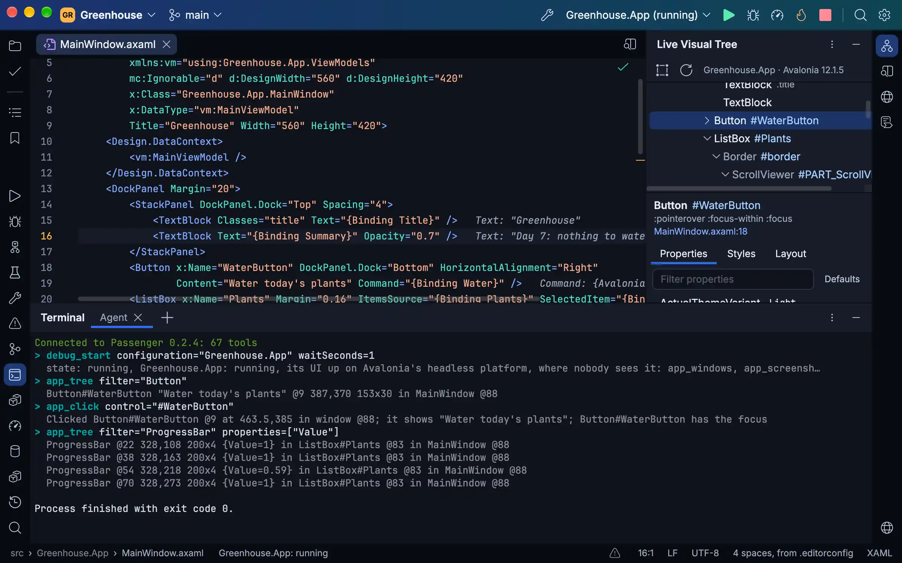
</picture>

Connect a coding agent such as Claude Code, Codex or OpenCode to Passenger and it works through the IDE, not just your
files. It finds where things are declared and used, reads the warnings, and renames, fixes and formats code as the IDE
does. It builds, runs and tests, sets breakpoints, steps, reads and changes variables, applies Hot Reload and profiles a
run. It starts, debugs and stops a compose service or an Aspire resource and reads its logs, traces and metrics, reads a
web app's routes and live requests, runs the EF Core migrations, commits, resolves conflicts and adds packages. When the
program is an Avalonia app, a Godot game, or a WPF app on Windows, it sees and drives it as a person testing it would,
without taking your focus or your pointer, and through Passenger's addon it changes scenes in your Godot editor, each
change one step of Godot's Undo.

There are two ways in, each a flag on Passenger's own executable:

- **`--mcp-attach`** joins the window you have open over the folder the agent works in (`--mcp-attach PID` chooses one
  of Passenger's windows), so its breakpoints and stops show in your editor and its runs in your Run window; its first
  call opens the folder in Passenger, starting it if need be, and it never joins a window on another folder. The window
  asks you before it lets an agent in (Allow, Don't allow, or Always for this folder), unless you have turned on
  Settings | MCP Server | Enable MCP Server, and asks again the first time the agent uses a tool that changes anything.
  A question not answered within two minutes comes back to the agent as nobody having answered.
- **`--mcp FOLDER`** starts a Passenger of the agent's own with no window, over a folder or solution, for work it does
  alone. It asks nothing, so it suits an agent you leave to work while you are away.

Passenger's own Settings | MCP Server shows each agent's setup with this copy's path filled in, each with a Copy button,
and the website's [agents page](https://passenger-ide.net/agents) has the same setups, Claude Desktop's, the Codex
desktop app's and OpenCode's among them. Passenger is `/Applications/Passenger.app/Contents/MacOS/Passenger` on a Mac,
`%LOCALAPPDATA%\PassengerIDE\current\Passenger.exe` on Windows, and `~/.local/bin/passenger-ide` on Linux
(`/usr/local/bin/passenger-ide` when installed for everyone). A repository's `.mcp.json` gives it to everyone who works
there with Claude Code:

```json
{
  "mcpServers": {
    "passenger": {
      "command": "/Applications/Passenger.app/Contents/MacOS/Passenger",
      "args": ["--mcp-attach"]
    }
  }
}
```

Or add it for yourself:

```sh
# Claude Code
claude mcp add passenger -- /Applications/Passenger.app/Contents/MacOS/Passenger --mcp-attach
# Codex CLI
codex mcp add passenger -- /Applications/Passenger.app/Contents/MacOS/Passenger --mcp-attach
```

A call that takes a while (a build, a test run, a debug session waiting for a stop) tells the agent what it is doing
every 10 seconds when the agent asks for progress. With Settings | Diagnostics | Trace protocol messages on, `mcp.log`
in the logs folder has each agent's call, what it waited on and for how long.

This repository's own [`.mcp.json`](.mcp.json) runs [`tools/mcp.sh`](tools/mcp.sh), the script `just mcp` runs too: the
last Debug build with `--mcp` over this folder, run from a clone of the build so rebuilding Passenger never changes the
files under the agent's IDE.

## Building

Building needs the .NET 11 SDK (11.0.100 or a later 11.0 SDK, as [`global.json`](global.json) asks) and
[just](https://github.com/casey/just). The tests need more:

- **the .NET 10 SDK** beside it, since the programs the debugger's tests debug ([`tests/Debuggees`](tests/Debuggees))
  and most projects the tests write run on .NET 10;
- **Git**, which the IDE runs for its Git features and the tests for theirs;
- on Linux, **the X11 and fontconfig libraries** [Passenger's Linux page](https://passenger-ide.net/linux) names, which
  the headless tests draw their text with too;
- **Node.js**, for the web languages' tests, which skip without it, saying why;
- **a container engine running Linux containers** (Docker Desktop, Docker Engine, Colima, OrbStack), for the container
  tests, which skip without one, saying why.

**Python 3** runs `just test` and the recipes that write or check generated files (`just icons`, `just file-icons`, `just themes`,
`just unicode-widths`, `just notices`, `just test-times`) and some of the macOS ones (`just app-icon`,
`just package-mac`, `just site-shots`). To use what you build, Passenger needs what a release needs
([installing](#installing)).

```sh
just build                 # Debug build; warnings are errors
just run [PATH]            # run it on a folder or solution (--theme dark|light, --look passenger, harbour, sorbet…)
just test [FILTER]         # every test, the IDE driven whole on Avalonia's headless platform, or those matching;
                           # the results in artifacts/test-results
just screenshot shell.png  # draw the main window to a PNG off-screen (--size 1600x1000 --scale 2)
just mcp [FOLDER]          # Passenger as an MCP server over a folder, from a clone of the last build
just publish osx-arm64     # a self-contained Release build (win-x64, win-arm64, linux-x64, linux-arm64 too)
just package-mac           # the macOS disk image, Apple Silicon; signed with PASSENGER_SIGN_IDENTITY, else ad hoc
just package-win win-x64   # the Windows installer (or win-arm64), unsigned unless tools/package-win.sh's variables sign it
just package-linux         # the Linux archive with its install.sh (linux-x64, or linux-arm64), as site/linux.html uses it
just container-tools       # the tools Passenger debugs and profiles with inside a Linux container, where a build finds them
just notices               # fail naming any package THIRD_PARTY_NOTICES.md does not name
```

Every recipe sets `AVALONIA_TELEMETRY_OPTOUT=1`. Avalonia's build task (Avalonia.BuildServices, which every Avalonia
package brings) otherwise sends AvaloniaUI a record of each build: a machine id it keeps, hashes of the machine and
user names and of the project's name, the system, the IDE and the CI it ran under. It reads its opt-out only from the
environment, so set the variable yourself for a build outside `just` (`dotnet build`, an IDE's).

Packages come only from nuget.org (`nuget.config`), at the versions and content each project's `packages.lock.json`
pins, and on Windows and Linux only as nuget.org signed them (NuGet checks no signatures on macOS). A restore on your
machine updates a lock file when you add or change a package; commit it with the change, since CI restores only what
the lock files name.

The website is [`site/`](site), plain HTML and CSS deployed to [passenger-ide.net](https://passenger-ide.net) when the
Site workflow is run by hand.

## Contributing

[`CONTRIBUTING.md`](CONTRIBUTING.md) says how to report a bug, propose a change and open a pull request, and what
working on Passenger needs.

## Licence

MIT (`LICENSE`). Third-party code and assets keep their own licences, listed in `THIRD_PARTY_NOTICES.md`.
